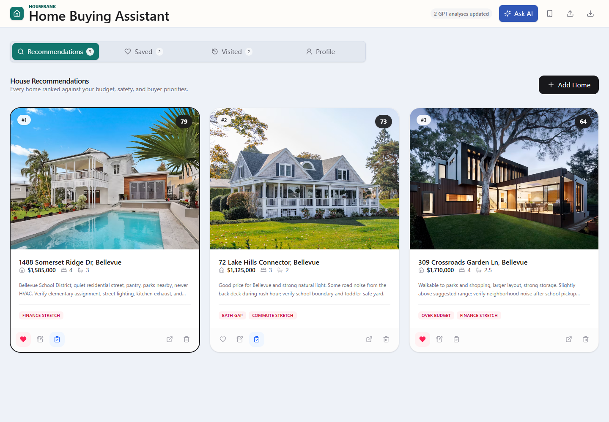
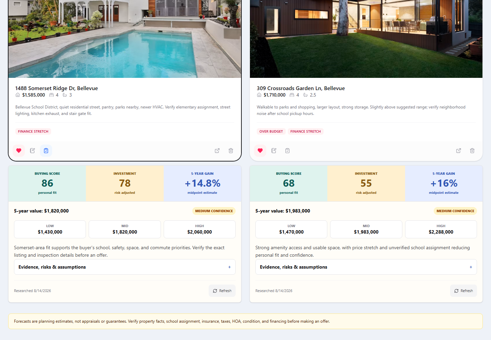
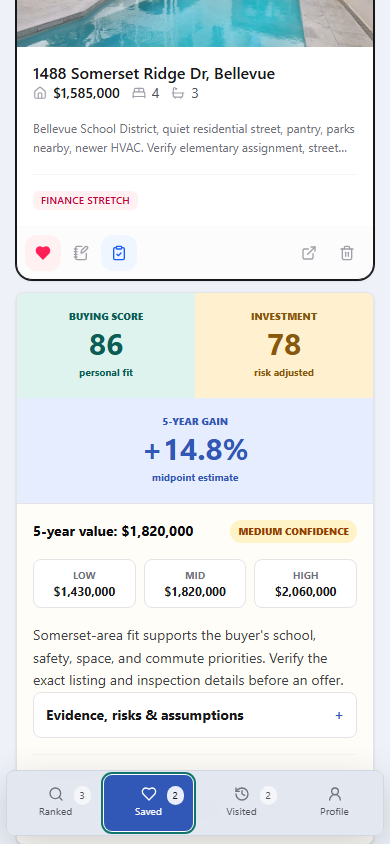
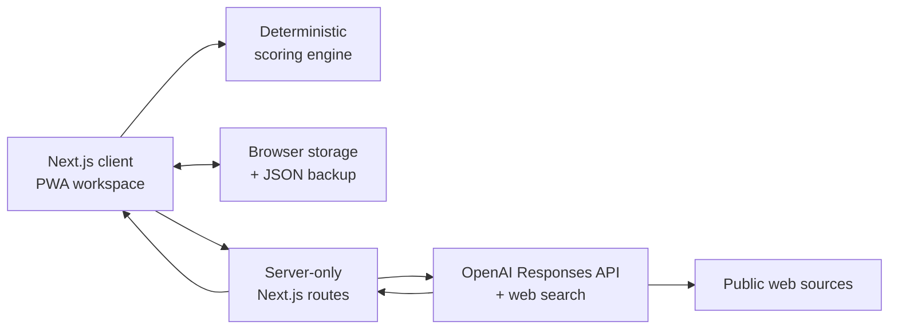

<div align="center">

# HouseRank

**A local-first, AI-assisted decision workspace for the most expensive comparison most people ever make.**

[](https://housebuyer-app.vercel.app)
[](https://github.com/RishabhKumar124/houserank/actions/workflows/ci.yml)
[](https://nextjs.org)
[](https://platform.openai.com/docs/api-reference/responses)
[](LICENSE)

[Try the app](https://housebuyer-app.vercel.app) | [Recruiter brief](docs/RECRUITER_BRIEF.md) | [Architecture](docs/ARCHITECTURE.md) | [Engineering decisions](docs/ENGINEERING_DECISIONS.md) | [Report an issue](https://github.com/RishabhKumar124/houserank/issues)

</div>



## Why HouseRank exists

House hunting mixes objective constraints with impressions that are difficult to remember after the fifth showing. Listing sites are excellent discovery tools, but they do not answer the buyer-specific question: **which home is the best decision for me?**

HouseRank keeps that decision legible. It combines a transparent local score, structured in-person observations, buyer context, and source-backed GPT research without pretending that an AI forecast is an appraisal.

## Reviewer scan path

| If you have... | Start here | What to look for |
| --- | --- | --- |
| **30 seconds** | The screenshot and system map | The product is real, mobile-aware, and built around a clear decision loop. |
| **2 minutes** | [Recruiter brief](docs/RECRUITER_BRIEF.md) | Product judgment, AI boundaries, privacy stance, and why the architecture matters. |
| **5 minutes** | [Architecture](docs/ARCHITECTURE.md) and [Engineering decisions](docs/ENGINEERING_DECISIONS.md) | How the scoring, OpenAI research, local persistence, and fair-housing constraints fit together. |
| **10 minutes** | `app/api/analyze-houses/route.ts`, `app/page.tsx`, and `tests/product-contracts.test.mjs` | Structured AI output, source handling, frontend workflow, and testable product contracts. |


## Product highlights

| Capability | What makes it useful |
| --- | --- |
| **Buyer-aware profile** | Turns budget, income, liquidity, family logistics, commute, schools, must-haves, and free-form context into a reusable decision lens. |
| **Transparent baseline score** | Ranks every tracked home using deterministic affordability, property-fit, commute, and visit criteria. The math works without AI. |
| **Deep GPT research** | Automatically researches each newly saved home, returning a personal buying score, risk-adjusted investment score, five-year value range, confidence, assumptions, risks, and clickable sources. |
| **20-factor tour scorecard** | Captures noise, light, smell, layout, stairs, storage, street feel, maintenance signals, and the details that disappear after a busy tour day. |
| **Local-first privacy** | Buyer profiles, notes, scores, and research results stay in browser storage. JSON import/export provides a portable backup. |
| **Mobile field workflow** | Installable PWA, share-target support, bottom navigation, and narrow-screen containment make the app usable while touring homes. |

<table>
  <tr>
    <td width="64%"></td>
    <td width="36%"></td>
  </tr>
</table>

## How it works

1. **Define the buyer** - add financial boundaries and describe the life the home needs to support.
2. **Track candidates** - paste a listing URL or enter a property manually.
3. **Compare the baseline** - every home receives the same deterministic scoring treatment.
4. **Save for deep analysis** - saved homes automatically run independent, source-backed GPT research in the background.
5. **Score the visit** - record structured observations from `-2` to `+2` while the showing is still fresh.
6. **Sort the shortlist** - compare personal fit, investment quality, projected growth, or the baseline score.

## Scoring philosophy

HouseRank deliberately shows two kinds of judgment instead of collapsing them into one opaque number:

- **Baseline score** is deterministic and inspectable. It weights affordability, target beds and baths, commute, profile terms, and visit ratings. Financial stress caps an otherwise attractive total.
- **Buying score** asks how well the home fits this buyer's actual priorities, logistics, finances, and observations.
- **Investment score** measures risk-adjusted percentage upside, price versus market evidence, demand, supply, resale liquidity, and carrying-cost risk. It does not reward a property merely because its absolute dollar gain is larger.

Five-year values are presented as **low / midpoint / high scenarios with confidence and assumptions**, never as guaranteed appreciation.

## Architecture



The API key never reaches the browser. Research responses use a strict JSON schema, retain only web-search-returned source URLs, and are normalized before reaching local storage. See the [architecture deep dive](docs/ARCHITECTURE.md).

## Responsible AI and privacy

- Listing facts that cannot be verified are labeled as assumptions and reduce confidence.
- Neighborhood research cannot use race, ethnicity, nationality, religion, disability, sex, or family status as ranking proxies.
- Amenity requests are treated only as distance preferences.
- Financial output is planning guidance, not lending, investment, or appraisal advice.
- No buyer profile, visit note, or saved home is stored in a project database in this version.
- OpenAI requests use `store: false`; selected profile and property context is still transmitted when AI features run.

## Run locally

### Prerequisites

- Node.js 22
- npm 10+
- An OpenAI API key only if you want AI chat and property research

```bash
git clone https://github.com/RishabhKumar124/houserank.git
cd houserank
npm ci
cp .env.example .env.local
npm run dev
```

Open [http://localhost:3000](http://localhost:3000). The deterministic tracker works without an API key.

```env
OPENAI_API_KEY=your_server_side_key
```

Never prefix this variable with `NEXT_PUBLIC_`.

## Quality gates

```bash
npm run typecheck       # strict TypeScript validation
npm run lint            # React, accessibility, hooks, and Next.js rules
npm test                # product contracts + API configuration tests
npm run build           # Next.js production build
npm run screenshots     # deterministic portfolio screenshots
```

GitHub Actions runs the quality gate and the Next.js production build as independent jobs on every push and pull request.

## Technology

- Next.js 16, React 19, TypeScript 5
- Tailwind CSS 4, Framer Motion, Lucide icons
- OpenAI Responses API with built-in web search and Structured Outputs
- Browser storage, service worker, Web App Manifest, share target
- Node test runner, Playwright, ESLint 9, GitHub Actions
- Vercel production deployment on the standard Next.js runtime

## Honest limitations

- HouseRank does not scrape or log in to Zillow, Redfin, or Realtor. Portal integrations should use approved APIs, partner feeds, or user-authorized exports.
- Automatic deep research completes while the app remains open. Durable work after force-closing the browser would require authenticated server storage and a job queue.
- Browser-local data does not sync across devices yet.
- The bundled sample properties are synthetic demonstration data.

## Roadmap

- Authenticated cross-device sync with explicit data deletion controls
- Durable research jobs with progress events and cached area-level evidence
- Verified property feeds and county-record enrichment
- Side-by-side offer scenarios and ownership-cost modeling
- Exportable comparison reports for partners, agents, and lenders

## More

- [Architecture and data flow](docs/ARCHITECTURE.md)
- [Engineering decisions and tradeoffs](docs/ENGINEERING_DECISIONS.md)
- [Contributing](CONTRIBUTING.md)
- [Security and privacy reporting](SECURITY.md)

Built by [Rishabh Kumar](https://github.com/RishabhKumar124). Licensed under the [MIT License](LICENSE).
