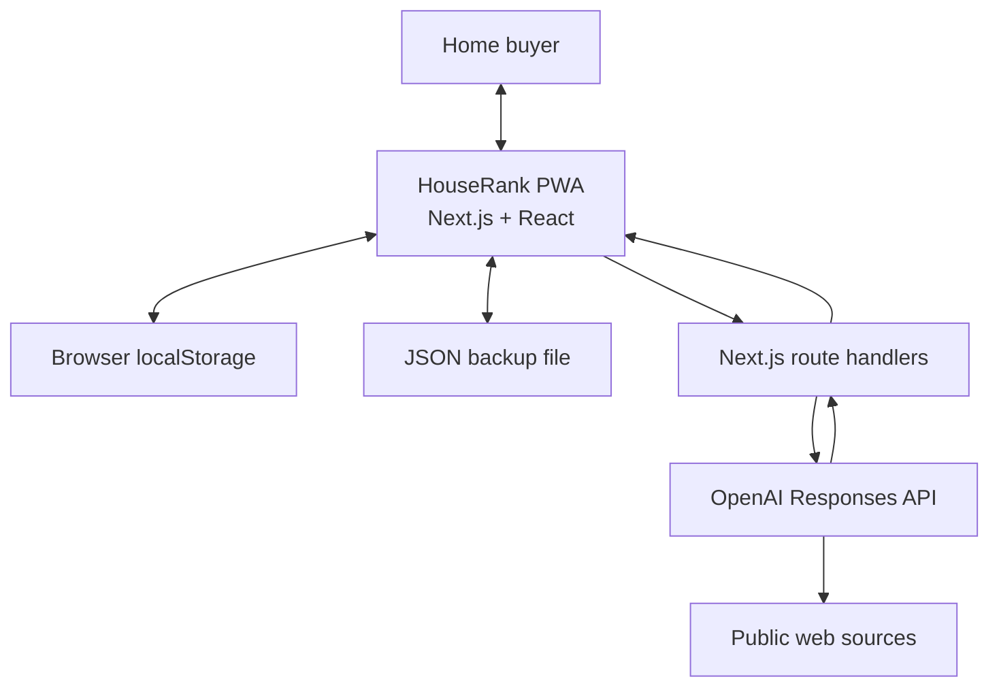
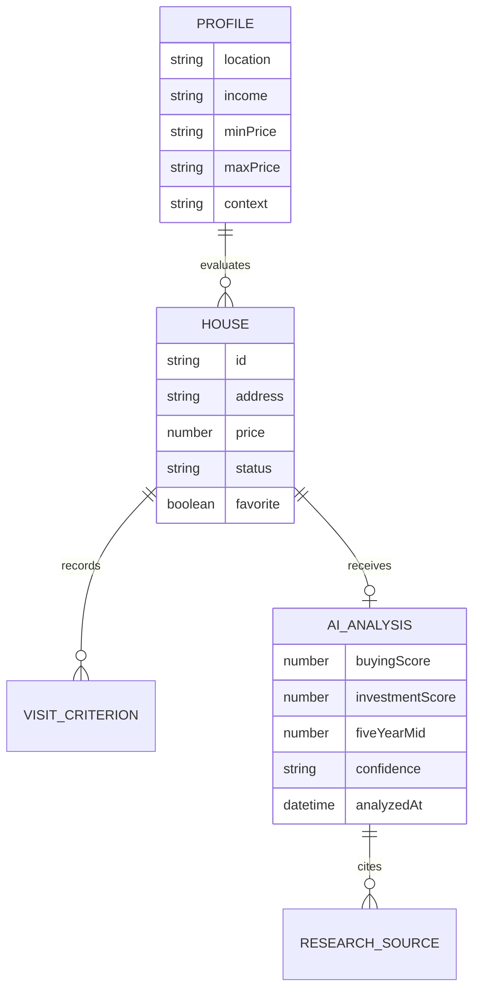

# Architecture

HouseRank is a local-first decision-support application with an optional server-side AI research layer. The architecture keeps the core product useful when OpenAI is unavailable and keeps private buyer data out of an application database.

## System context

## Runtime boundaries

### Browser

- Owns the buyer profile, tracked homes, visit criteria, saved state, and AI results.
- Recomputes the deterministic baseline score with every relevant edit.
- Persists a versioned JSON document under `houserank-local-v2`.
- Starts deep research automatically for saved homes without an existing analysis.
- Runs up to three homes per automatic wave; each home is an independent request so results can arrive progressively.

### Server routes

`app/api/assistant/route.ts` provides bounded conversational help over the current profile and tracked homes.

`app/api/enrich-listing/route.ts` powers add-home intake:

1. Accepts a listing URL/address and an optional user-provided listing screenshot from the browser form.
2. Uses the OpenAI Responses API with image input to read screenshot-visible facts, or web search when no screenshot is provided.
3. Enforces a strict JSON schema for form fields, missing fields, assumptions, and sources.
4. Normalizes numeric fields before returning them to the browser.
5. Prefills only empty draft fields so the buyer reviews the result before saving.

`app/api/analyze-houses/route.ts` performs deep property research:

1. Validates the request and caps the accepted batch size.
2. Sends buyer and property context to the OpenAI Responses API.
3. Enables built-in web search with high context.
4. Enforces a strict JSON schema for scores, scenarios, risks, and assumptions.
5. Extracts URL citations and search sources from the API response.
6. Rejects model-supplied source URLs that were not returned by web search.
7. Normalizes score bounds, forecast ordering, and fair-housing-sensitive phrasing.
8. Returns a typed result to the browser for local persistence.

The `OPENAI_API_KEY` is read only inside route handlers.

## Scoring model

### Deterministic baseline

The local score starts from a neutral baseline and adjusts for:

- budget fit and financial stretch
- target bedrooms and bathrooms
- commute tolerance
- must-have and dealbreaker term matches
- explicit school and safety priorities
- structured visit ratings

Finance can cap the final score. This prevents a beautiful but clearly unaffordable home from ranking first because of subjective visit ratings.

### GPT buying score

The buying score uses the baseline as one input and adds researched context, profile fit, daily logistics, objective safety evidence, verified school assignment, notes, and uncertainty.

### Investment score

The research prompt defines a risk-adjusted framework:

| Weight | Signal |
| ---: | --- |
| 35% | Expected percentage appreciation relative to local alternatives |
| 20% | Price versus defensible comps or market level |
| 15% | Durable demand and resale liquidity |
| 15% | Supply and infrastructure outlook |
| 15% | Carrying-cost and property-condition risk |

The output includes nominal low, midpoint, and high five-year scenarios. The midpoint percentage is used for growth sorting; the investment score remains the more complete comparison.

## Data model

The shared types live in `lib/types.ts`.

## Deployment paths

- **Vercel:** standard `next build`, server route handlers, production alias at `housebuyer-app.vercel.app`.
- **Production:** Vercel builds and runs the standard Next.js App Router application.

The CI pipeline tests both the framework-neutral quality gate and a clean Next.js production build.

## Security and privacy properties

- No API key in client bundles.
- No secrets or `.env.local` files tracked in Git history.
- OpenAI requests set `store: false`.
- Request context is size-bounded.
- Listing and source links are rendered with `rel="noreferrer"`.
- Imported backups are parsed defensively and merged with current defaults.
- Research is advisory and includes visible confidence, risks, and assumptions.

## Scaling path

The local-first model is intentional for the personal-use stage. A multi-user version would add:

1. Authentication and tenant-scoped storage.
2. Encrypted profile and property records with deletion/export controls.
3. Durable research jobs and progress events.
4. Cached geographic evidence separated from property-specific research.
5. Approved listing feeds instead of scraping.
6. Prompt/version metadata and offline evaluation fixtures for score regressions.
