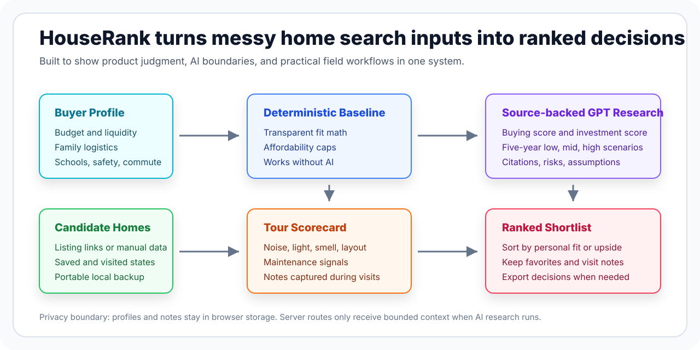

# HouseRank recruiter brief

HouseRank is a portfolio-grade AI product that turns home buying from a scattered set of listing tabs, memories, and gut reactions into a structured decision workspace.

## The product problem

Home buyers do not only need more listings. They need help comparing the few serious candidates against their real life: budget stress, commute, school needs, safety priorities, family logistics, visit impressions, and long-term resale risk.

HouseRank focuses on that decision moment. It gives every home a transparent baseline score, captures the field notes that usually get forgotten, and adds optional source-backed GPT research for buying fit and investment outlook.

## What makes the build worth reviewing

| Area | Signal |
| --- | --- |
| Product judgment | The app separates deterministic fit, personal buying fit, and investment quality instead of hiding everything behind one generic AI score. |
| AI system design | GPT & **LangGraph Multi-Agent Architecture** coordinate specialized agents (Listing Intelligence, Financial Modeling, and Lifestyle Fit) synthesized into calibrated Personal Fit and Investment Potential scores. Structured outputs, citations, confidence, assumptions, and fair-housing guardrails are part of the product contract. |
| Frontend craft | The workflow supports profile setup, recommendations, saved homes, visited notes, mobile use during tours, and PWA installation. |
| Engineering maturity | Next.js 16, React 19, strict TypeScript, API tests, linting, production build checks, CI, Dependabot, security docs, and documented tradeoffs. |
| Privacy stance | Personal data stays local by default. The API key is server-only, OpenAI calls use `store: false`, and the app does not scrape listing portals. |

## System map

## Interesting implementation details

- The deterministic baseline remains useful even if OpenAI is unavailable or slow.
- Saved homes trigger background deep research, which fits how buyers naturally shortlist properties.
- The investment score is risk-adjusted percentage upside, not raw dollar gain.
- The research route validates output shape, clamps scores, orders five-year scenarios, and allows only source URLs returned by web search.
- The product explicitly avoids ranking neighborhoods by protected-class proxies.

## Where I would take it next

1. Add authenticated sync and encrypted server storage.
2. Move background research into durable jobs with progress events.
3. Add licensed property feeds, county records, and school-assignment verification.
4. Introduce regression fixtures for AI scoring quality.
5. Build shareable decision reports for buyers, agents, and lenders.

## Links

- Live product: https://housebuyer-app.vercel.app
- Source: https://github.com/RishabhKumar124/houserank
- Architecture: ARCHITECTURE.md
- Engineering decisions: ENGINEERING_DECISIONS.md
